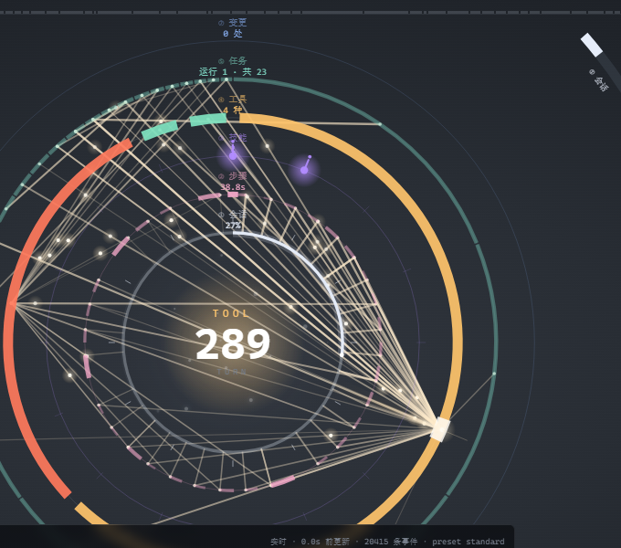

[中文](GUIDE.md) | **English** | [日本語](GUIDE.ja.md) | [한국어](GUIDE.ko.md) | [Русский](GUIDE.ru.md) | [हिन्दी](GUIDE.hi.md)

# GUIDE — using dsh-visualization

## 1. What this is

A DeepSeek Harness plugin that draws the **current session** as an instrument: one ring icon in the sidebar,
and opening it shows seven concentric rings (session, steps, skills, tools, jobs, approvals, file changes)
plus a turn timeline and an event table.

All data comes from `~/.dsh/sessions/**` (read-only). Nothing is sent anywhere.

## 2. Install

```powershell
# search "dsh-visualization" in the plugin market
npm i dsh-visualization
```

A ring icon appears in the sidebar; click it to fill the main panel. No configuration — it follows the
session you have open.

**Requirement**: host Node ≥ 22.15. When that is missing the panel says so instead of showing a blank page.

## 3. First look

The panel has three areas:

| Area | Content |
|---|---|
| centre | the rings; the number in the middle is the current **turn** |
| right column | session flow, context, background jobs, subagents, agent team, turn timeline |
| bottom | event table, grouped by turn, newest first |



Direction matters: **12 o'clock is the newest data**; older data runs clockwise.

## 4. Reading the rings

| Ring | Meaning |
|---|---|
| ① Session | context usage plus the last 12 turns as ticks |
| ② Steps | time slices; a fatter slice means that step took longer |
| ③ Skills | 16 slots; loading a skill lights one, with a line to when it was last used |
| ④ Tools | sectors by call count (or by time) |
| ⑤ Jobs | one arc per background job, length ∝ runtime |
| ⑥ Approvals | one tick per approval, colour is the outcome |
| ⑦ Changes | one tick per file change, deliverables taller |

Every layer can be switched off (see the controls); the remaining rings redistribute to fill the space.

## 5. Controls

They live in the translucent panel on the left, in four rows: session, ring toggles, view/scope/agents, replay.


| Control | Effect |
|---|---|
| `session` select | follow automatically, or pin one session |
| `①…⑦` | toggle each layer |
| `spin` | rings ②③④ rotate slowly |
| `lines` | ladders / beams / both |
| `share` | tool ring by call **count** or by **time** |
| `line turns` | how many turns get connectors |
| `show turns` | how many turns the panel covers (or all) |
| `circles` | how many subagent mini-rings on the left (0 / 2 / 4 / 6 / 8 / 12) |
| `team` | how many team members on the right (0 / 1 / 2 / 3 / 4 / 6 / 8) |
| `⚙ settings` | text size, layout, export |
| `language` select | six interface languages |
| `replay` | replay historical events |

`line turns` is always clamped to `show turns` — a connector can never point at a turn the panel is not showing.

**Your choices live on the plugin side** (`~/.dsh/dsh-visualization-prefs.json`), not in a browser profile, so
the panel, the desktop wallpaper and any browser all show the same settings.

On ring ②, **dim** cells sit outside `line turns`; a **lit** cell with no line means that step called no tools.

**Model info**: under the context block the right column lists **model / provider / reasoning effort**.
- Data comes from the `model/selection` event (`{ provider, model, reasoningEffort }`), so a switch shows up **immediately**, without waiting for the next request
- Turns where the model changed carry a `⇄ model` marker in the turn timeline; hover for the full `provider/model · effort`
- The subagent table and the team member table each have a **model** column: workers and teammates may run a different model than the lead (cheap model for grunt work), and you can see who uses what at a glance

## 6. Hover and click

Every node on the rings reacts:

- **hover** — a tooltip with the name and a one-line summary
- **click** — a detail card; for tools it lists the **last 6 real commands** and their durations

## 7. Language

The select at the bottom right offers **six languages**: 中文 / English / 日本語 / 한국어 / Русский / हिन्दी.

- It follows the browser language by default; the choice is stored in `localStorage`
- `?lang=ja` and friends override it for one visit
- **Translated**: UI strings, buttons, table headers, ring labels, templated count lines
- **Not translated**: tool names, session ids, DSH's own field names (`assistant`, `TURN`) — those stay Chinese

## 7.1 Keyboard

| Key | Action |
|---|---|
| `Space` / `R` | replay / pause |
| `1`–`7` | toggle that ring |
| `Esc` | close the detail card |

Keys are ignored while you type in an input.

## 8. As a desktop wallpaper

You only need **Lively** — it renders with the native engine at the display's frame rate.

1. Install [Lively Wallpaper](https://github.com/rocksdanister/lively) (free, open source)
2. Download [`wallpaper/lively-package.zip`](wallpaper/lively-package.zip)
3. Drag the zip into Lively, or **add wallpaper → open file** → pick the extracted `index.html`

The page finds the plugin at `127.0.0.1:8799`; when DSH is off it shows a hint and retries every 5 seconds.

**The panel stays clickable on the desktop** — Lively forwards mouse input. If that gets in the way of your
desktop icons, turn icon display off in Lively's settings.

Port fallback (8799 → 8795) is documented in [`wallpaper/README.en.md`](wallpaper/README.en.md).

## 8.5 Compaction, model failures and runtime

Long sessions trigger **context compaction**: the model folds the earlier conversation into a summary and drops old
messages. The panel makes that visible:

- A line under the context block: `⇩ 2 compactions · 129.5k pruned · last T283 · ## summary…` (hover for the full summary)
- The compacted turn carries a `⇩ compact` marker in the timeline
- `compact` / `prune` entries show up in the event log (layer = state)

**Model failures**: `⚠ N failures` sits at the top right of the runtime block, and the event log carries `llm-err`
entries (red ×) whose detail is the provider's error text — with third-party APIs (opencode-go and friends) region
restrictions, quota and image-budget errors all land here.

The runtime block also shows the current sandbox mode (`danger-full-access` / `workspace-write` / `read-only`),
permission level and plan mode. Switching any of them leaves a `sandbox` / `permission` / `plan` entry in the log.

## 9. Troubleshooting

| Symptom | Cause |
|---|---|
| "zstd unsupported" | host Node < 22.15 |
| session directory is empty | this profile has no conversations yet |
| blank page, 403 over the network | not loopback; only enable `allowRemote: true` if you really need it |
| dim cell without a line | outside `line turns` |
| lit cell without a line | that step called no tools |
| wallpaper shows "offline" | DSH is off, or the plugin is disabled |
| "⚠ parse warnings" on the source line | one event failed to parse; the rest of the state is intact |

## 10. Privacy and uninstall

- The host reads `~/.dsh/sessions/**` read-only and folds it **in memory**; no session file is written
- Neither half makes outbound requests; routes answer loopback only
- Uninstall: disable it on the plugin page, or `dsh plugin remove dsh-visualization`; your logs stay untouched

## 11. Subagents

When the session delegates with `subagent` / `subagent_fork`, a **SUBAGENTS** block appears in the right column:

```
SUBAGENTS / delegated agents         2 · 1 running
agent            turns tools  last
● cordis · 8a13a69a   1    2    9s      ← green = still running
```

**Click a row** to switch into that child session. The same agents appear as **mini instruments left of the
main ring** (three arcs: turns / tools / steps); the running one glows, and its active layer is brighter.
The `circles` chip decides how many are drawn.

They are found by reading `parentSession` from each sub-session's first event, so only agents this session
actually spawned are listed.

## 12. Agent team

With team mode on (enable **agent teams** in the root session's model menu), the right column gains a
**members and task board** block:

```
TEAM / members and task board        1 member · pending 1 / active 1 / done 1
member         phase    tasks
lead           active   1
task                          state    owner
● verify the team panel       active   lead
```

To the **right of the main ring** each member gets a **giant arc** split into seven segments that mirror the
seven rings (session / steps / skills / tools / jobs / approvals / changes); each segment fills according to
that member's relative value and takes the ring's colour. The innermost arc carries the segment names. Hover
an arc to see all seven numbers for that member.

How many members are drawn is controlled by the `team` chip; `lead` (your current session) is always listed.

## 13. Settings and export

Click **⚙ settings** to open the drawer:

| Item | Effect |
|---|---|
| theme | dark / light (light inverts the page; ring hues are preserved) |
| text size | compact / standard / large — scales both tables and canvas labels |
| turn end | looping ripple / one ripple / breathe / badge only / off |
| layout | standard / compact (hides the right column so the rings use the full width) |
| export | save PNG (current rings view) / save JSON (complete state) |

These persist on the host side together with the other display prefs, shared by the panel and the wallpaper.
