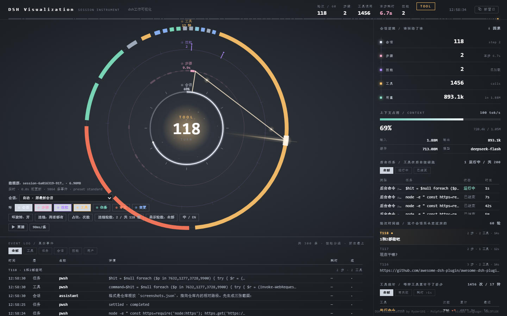
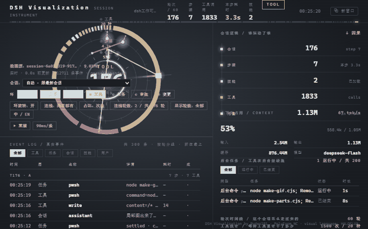
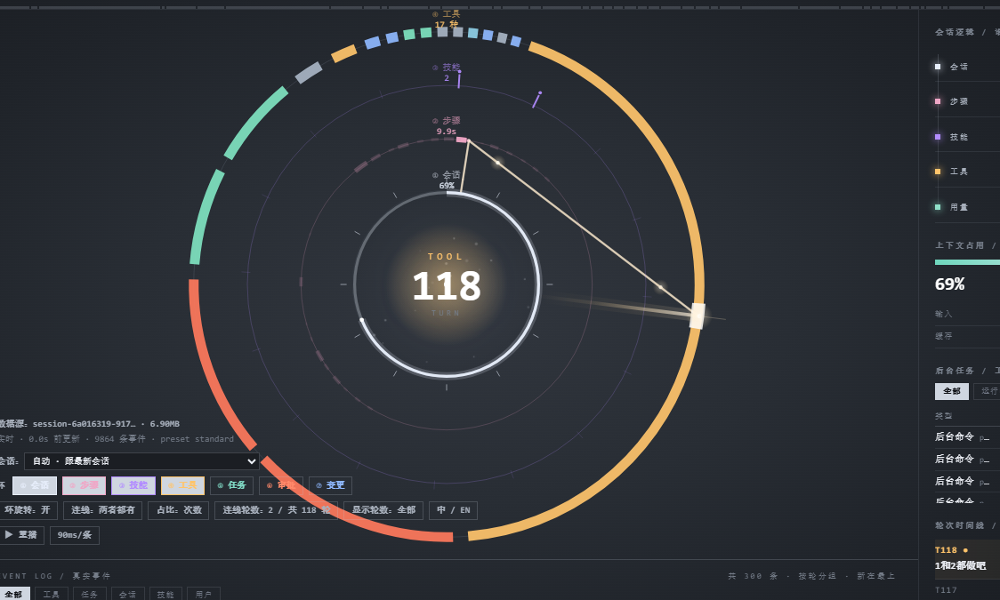
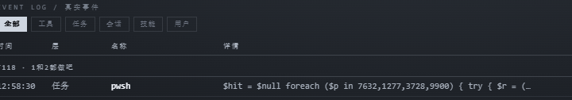
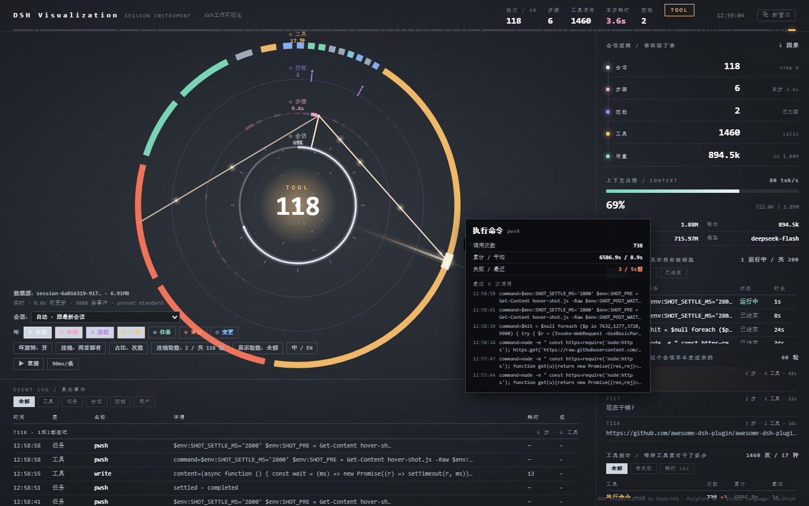
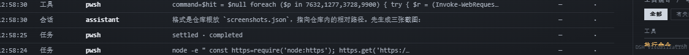

[中文](GUIDE.md) | **English**

# GUIDE — using dsh-visualization

The user guide. English first, **[中文](#中文)** at the bottom.
For changing the code see [AGENTS.en.md](AGENTS.en.md); for "why is it like this" see [FAQ.en.md](FAQ.en.md).

---

## 1. What this is

A DeepSeek Harness plugin that turns the **current session** into an instrument panel: a sidebar icon,
and a full panel showing seven concentric layers — session, steps, skills, tools, jobs, approvals,
file changes — plus a turn timeline and an event log.

Everything comes from `~/.dsh/sessions/**` (read-only). Nothing is sent anywhere.





## 2. Install

```powershell
# marketplace / Plugins page: search "dsh-visualization"
npm i dsh-visualization
```

After installing, a ring icon appears in the left rail. Click it; the panel takes the main area.
Nothing else to configure — it follows whichever session you have open.

**Requirement**: Node ≥ 22.15 in the host. Without it the panel says so explicitly instead of
rendering blank.

## 3. First look

The panel is split in three:

| Area | Content |
|---|---|
| Centre | the rings; the number in the middle is the current **turn** |
| Right column | session flow, context usage, background jobs, turn timeline |
| Bottom | event log, grouped by turn, newest on top |



Direction matters: on the rings, **12 o'clock is the newest data**, older data runs clockwise.

## 4. Reading the rings

| Ring | What it shows |
|---|---|
| ① Session | context-window usage + the last 12 turn ticks |
| ② Steps | time buckets; thicker segment = more time spent in that slice |
| ③ Skills | 16 slots; one lights up per loaded skill, and a link runs to when it was last used |
| ④ Tools | composition by call count (or by time — see `share`) |
| ⑤ Jobs | one arc per background job, length ∝ runtime |
| ⑥ Approvals | one tick per approval, colour = outcome |
| ⑦ Changes | one tick per file change; deliverables are taller |

Each ring can be switched off independently (see the controls below); the remaining rings re-space
themselves to fill the gap.



## 5. Controls (bottom left)

| Control | What it does |
|---|---|
| `①…⑦` | toggle each layer |
| `spin` | slow rotation of ②③④ |
| `lines` | `ladders` (per-step chains), `beams` (from the core), or `both` |
| `share` | size the tool ring by call `count` or by `time` |
| `line turns` | how many turns get connectors |
| `show turns` | how many turns the whole panel covers (or `all`) |
| `⧉ window` | open a separate window you can drag to another monitor |
| `中 / EN` | switch language |

`line turns` is always clamped to `show turns` — a connector can never point at a turn the panel is
not showing.

**Your choices live on the plugin side** (`~/.dsh/dsh-visualization-prefs.json`), not in a browser
profile — so the panel, the desktop wallpaper and any browser all show the same settings, and switching
wallpapers does not reset them.

Bright vs dim segments on ②: a **dim** segment has no connector because it is outside `line turns`;
a **bright** segment with no line is a text-only step that called no tools.

## 6. Hover and click

Every node on every ring answers:

- **hover** — a tooltip with the name and a one-line summary
- **click** — a detail card; for tools it lists the last six actual commands with timings



## 7. Language

The UI ships in Chinese and English. It starts from `navigator.language`, remembers your choice, and
can be forced per page with `?lang=en` / `?lang=zh`.

## 8. As a desktop wallpaper

Two routes. **Lively is recommended** — it renders the page natively at full frame rate.

### Lively Wallpaper (full frame rate, interactive)

1. Install [Lively Wallpaper](https://github.com/rocksdanister/lively) (free, open source)
2. Download [`wallpaper/lively-package.zip`](wallpaper/lively-package.zip)
3. Drag the zip into Lively — or **Add Wallpaper → open file** → the extracted `index.html`

The page finds the plugin on `127.0.0.1:8799` by itself. If DSH is not running it shows a hint and
retries every 5 seconds.

**The panel stays clickable on the desktop** — Lively forwards mouse input, so ring toggles, turn
pickers and detail cards work directly on the background. If that makes desktop icons hard to click,
turn off icon display in Lively's settings.

### Wallpaper Engine (screenshot mode, ~5 fps)

Wallpaper Engine's own renderer crashes on this page (reproduced on its Chrome 146, independent of
protocol). The workaround is a screenshot pipeline:

```powershell
node wallpaper-live.cjs 200 78     # ≈4.9 fps, 200 KB/frame
```

Then set `wallpaper/live.html` as a Wallpaper Engine web wallpaper. A low-CPU variant (`node
wallpaper-capture.cjs 8`) refreshes every 8 seconds instead.

Full route comparison and the port fallback: [`wallpaper/README.en.md`](wallpaper/README.en.md).



## 9. Troubleshooting

| Symptom | Cause |
|---|---|
| Panel says "this runtime does not support zstd" | host Node < 22.15 |
| Panel says the session directory is empty | no conversation has run in this profile yet |
| Blank panel + 403 in the network tab | you are not on loopback; `allowRemote: true` if you really need remote access |
| A dim ring segment has no line | it is outside `line turns` |
| A bright segment has no line | that step called no tools |
| Wallpaper says "not connected" | DSH is not running, or the plugin is disabled |

## 10. Privacy and uninstall

- The host reads `~/.dsh/sessions/**` and folds it **in memory**. It writes no session files.
- No outbound network requests from either half; routes answer loopback only.
- Uninstall: disable the plugin on the Plugins page, or `dsh plugin remove dsh-visualization`.
  Your session logs are untouched.

---

## 11. Subagents (delegated agents)

When the session delegates work with `subagent` / `subagent_fork`, a **SUBAGENTS** block appears in
the right column, under the background-jobs block:

```
SUBAGENTS / delegated agents                2 · 1 running
agent                turns tools  last
● cordis · 8a13a69a      1     2    9s      ← green = still running
● cordis · 22db6314      1     0    6m
```

Each row is one delegated session. **Click a row** to switch the whole panel to that subagent's own
session — its rings, event log and tool calls, exactly as if you had opened it directly.

The same agents also appear as **mini versions of the instrument** to the left of the main ring: each
circle carries three arcs — outer = turns, middle = tool calls, inner = steps, each scaled against the
busiest sibling — with its turn count in the middle, its id and tool count underneath, and a dashed line
running from the main ring's edge to the circle (dashes drift while the agent is running). Green means
still running. Hover for details; click to switch into that session.

**A running agent lights up**: its circle gets a soft green halo and a pulsing outer ring, and the layer
matching what it is doing right now glows brighter — tool calls light the middle (amber) arc, step
progress lights the inner (pink) arc, and streaming text lights the outer (teal) arc. Finished agents fade
back to a flat outline.

How many circles appear is your call: the **子圆 / circles** chip cycles 0 → 2 → 4 → 6 → 8 → 12 (0 turns
them off). The table above always lists every subagent regardless of that setting.

The panel finds them by reading `parentSession` from each sub-session's first event, so it only lists
the agents this session actually spawned. Up to 12 in the table, 4 circles. No subagents → nothing shows.
