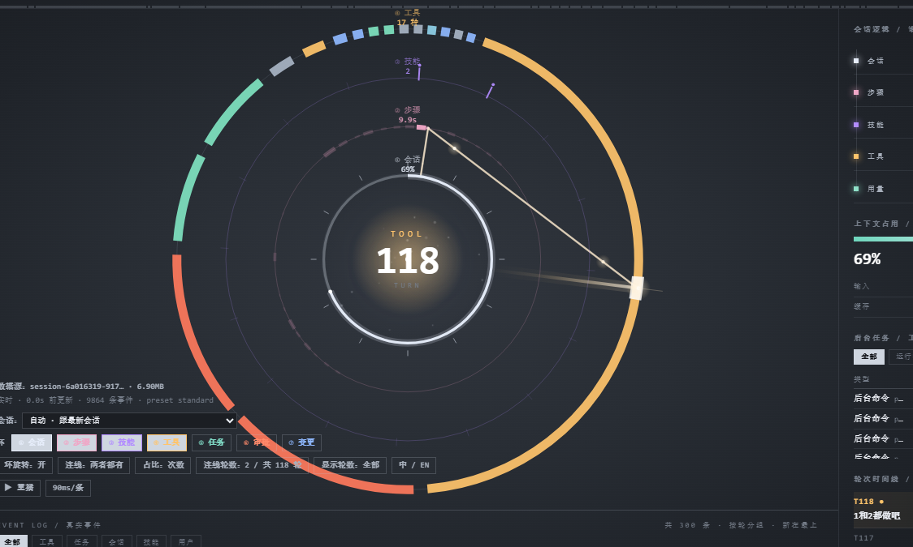
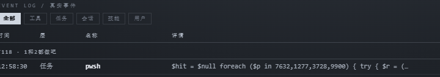
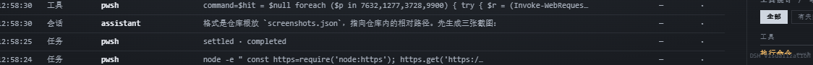

**[中文](GUIDE.md)** | [English](GUIDE.en.md)

# GUIDE — dsh-visualization 使用教程

## 1. 这是什么

一个 DeepSeek Harness 插件，把**当前会话**画成一台仪表盘：侧栏一个环图标，点开是七层同心环
（会话、步骤、技能、工具、任务、审批、文件变更）+ 轮次时间线 + 事件表。

数据全部来自 `~/.dsh/sessions/**`（只读），不发往任何地方。

## 2. 安装

```powershell
# 插件市场 / 插件页搜索 "dsh-visualization"
npm i dsh-visualization
```

装好后左侧栏出现环图标，点开占满主面板。不用配置——它跟随你当前打开的那个会话。

**要求**：宿主 Node ≥ 22.15。不满足时面板会直接说明，不会给你一个空白页。

## 3. 第一眼看到的

面板分三块：

| 区域 | 内容 |
|---|---|
| 中间 | 环；正中的数字是当前**轮次** |
| 右栏 | 会话逻辑链、上下文占用、后台任务、轮次时间线 |
| 底部 | 事件表，按轮分组，最新的在最上面 |



方向很重要：环上**12 点方向是最新的数据**，越旧越顺时针。

## 4. 怎么读环

| 环 | 表示什么 |
|---|---|
| ① 会话 | 上下文占用 + 最近 12 轮刻度 |
| ② 步骤 | 时间分格；格子越粗 = 那段时间花得越久 |
| ③ 技能 | 16 格；加载一个技能亮一格，并连一条线到"最近一次使用"的时刻 |
| ④ 工具 | 按调用次数（或耗时）分扇区 |
| ⑤ 任务 | 每个后台任务一段弧，弧长 ∝ 运行时长 |
| ⑥ 审批 | 每次审批一根刻度，颜色表示结果 |
| ⑦ 变更 | 每次文件改动一根刻度，交付物更高 |

每层都能单独关掉（见下面的控件），剩下的环会自动重新分布填满空间。



## 5. 控件（左下角）

| 控件 | 作用 |
|---|---|
| `①…⑦` | 开关每一层 |
| `环旋转` | ②③④ 缓慢自转 |
| `连线` | `阶梯`（逐步链）/ `光束`（从核心射出）/ `两者都有` |
| `占比` | 工具环按调用**次数**还是按**耗时** |
| `连线轮数` | 多少轮画连线 |
| `显示轮数` | 整个面板覆盖多少轮（可选「全部」） |
| `⧉ 新窗口` | 开一个独立窗口，可以拖到副屏 |
| `中 / EN` | 切换语言 |

`连线轮数` 永远被 `显示轮数` 钳制——不可能连到面板没显示的轮次上。

**你的选择存在插件侧**（`~/.dsh/dsh-visualization-prefs.json`），不在浏览器里。所以面板、桌面壁纸、
换个浏览器打开，看到的都是同一套设置——切换壁纸也不会丢。

② 环上亮与暗的区别：**暗**的格子表示它不在 `连线轮数` 范围内；**亮**但没线，说明那一步没有调用任何工具（纯文字步）。

## 6. 悬停与点击

环上每个节点都有反应：

- **悬停** —— 提示卡，显示名称和一句摘要
- **点击** —— 详情卡；工具还会列出**最近 6 次真实执行的命令**和耗时

## 7. 语言

界面中英双语。默认跟随 `navigator.language`，选择会记住，也可以用 `?lang=en` / `?lang=zh` 强制指定。

## 8. 当桌面壁纸用

两条路，**推荐 Lively**——它用原生内核满帧渲染。

### Lively（满帧、可交互）

1. 装 [Lively Wallpaper](https://github.com/rocksdanister/lively)（免费开源）
2. 下载 [`wallpaper/lively-package.zip`](wallpaper/lively-package.zip)
3. 把 zip 拖进 Lively，或者 **添加壁纸 → 打开文件** → 选解压后的 `index.html`

页面会自己找到插件的 `127.0.0.1:8799`；DSH 没开时显示提示并每 5 秒重试。

**桌面上可以直接操作面板**——Lively 会转发鼠标事件，环开关、轮次选择、详情卡都能在桌面上点。
如果这样导致桌面图标不好点，在 Lively 设置里关掉图标显示。

### Wallpaper Engine（截图模式，约 5 fps）

WE 自己的渲染器跑不动这个页面（在它的 Chrome 146 上复现，与协议无关）。替代方案是截图流水线：

```powershell
node wallpaper-live.cjs 200 78     # ≈4.9 fps，每帧 200 KB
```

然后把 `wallpaper/live.html` 设为 WE 的网页壁纸。低 CPU 版用 `node wallpaper-capture.cjs 8`（8 秒一帧）。

三种壁纸的完整对比和端口回退规则见 [`wallpaper/README.md`](wallpaper/README.md)。



## 9. 排错

| 现象 | 原因 |
|---|---|
| 面板说"不支持 zstd" | 宿主 Node < 22.15 |
| 面板说会话目录是空的 | 这个 profile 还没聊过 |
| 空白 + 网络面板 403 | 不是本机访问；确实要远程才开 `allowRemote: true` |
| 暗格子没有线 | 不在「连线轮数」范围内 |
| 亮格子没有线 | 那一步没有工具调用 |
| 壁纸显示"未连接" | DSH 没开，或插件被禁用 |

## 10. 隐私与卸载

- 宿主只读 `~/.dsh/sessions/**`，在**内存里**折叠，不写任何会话文件
- 前后两端都不发起对外网络请求；路由只响应本机回环
- 卸载：插件页禁用，或 `dsh plugin remove dsh-visualization`；你的会话日志原样不动

## 11. 子智能体（派出去的分身）

当会话用 `subagent` / `subagent_fork` 派活时，右栏「后台任务」下面会出现一块 **子智能体**：

```
子智能体 / 派出去的分身                2 个 · 1 在跑
分身              轮  工具  最近
● cordis · 8a13a69a   1    2    9s      ← 绿色 = 还在跑
● cordis · 22db6314   1    0    6m
```

每一行是一个被派出去的会话。**点一行**，整个面板就切到那个子智能体自己的会话——它的环、事件表、
工具调用都能看到，和在它自己窗口里看一样。

同样这些分身也会画成**主圆左边的迷你仪表盘**：每个小圆有三层弧——外圈=轮次、中圈=工具调用、
内圈=步骤，都按"最忙的那个兄弟"归一化——中间是它的轮次数字，下方是 id 前六位和工具数，
另有一条虚线从主圆边缘连到小圆（在跑的时候虚线会缓慢流动）。绿色表示还在跑，
悬停看详情，点一下切到那个会话。

**在跑的会亮**：那个小圆会出现一圈绿色光晕、外环呼吸式脉动，而且**它当前在干的那一层会更亮**——
调工具时中圈（琥珀）亮、推进步骤时内圈（粉）亮、出文字时外圈（青绿）亮。跑完的会退回普通描边。

画几个由你定：工具栏的 **子圆** 按钮循环 0 → 2 → 4 → 6 → 8 → 12（0 = 关）。
上方的表格不受这个设置影响，永远列出全部子智能体。

识别方式是读子会话第一条事件里的 `parentSession`，所以只列**这个会话真正派出去的**：
表格最多 12 个，小圆最多画 4 个。没有子智能体时两者都不出现。
