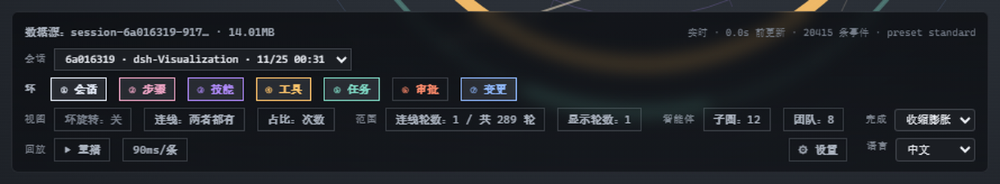

[中文](GUIDE.md) | [English](GUIDE.en.md) | [日本語](GUIDE.ja.md) | [한국어](GUIDE.ko.md) | **Русский** | [हिन्दी](GUIDE.hi.md)

# GUIDE — как пользоваться dsh-visualization

## 1. Что это

Плагин DeepSeek Harness, который рисует **текущую сессию** как прибор: значок кольца в боковой панели,
а при открытии — семь концентрических колец (сессия, шаги, навыки, инструменты, задачи, апрувы, правки
файлов), хронология ходов и таблица событий.

Все данные берутся из `~/.dsh/sessions/**` (только чтение). Никуда не отправляются.

## 2. Установка

```powershell
# найдите "dsh-visualization" в маркете плагинов
npm i dsh-visualization
```

В боковой панели появится значок кольца; нажмите — панель займёт основную область. Настройка не нужна:
она следует за открытой сессией.

**Требование**: Node ≥ 22.15 на хосте. Если его нет, панель скажет об этом, а не покажет пустую страницу.

## 3. Что видно сразу

Панель делится на три области:

| Область | Содержимое |
|---|---|
| центр | кольца; число в середине — текущий **ход** |
| правая колонка | поток сессии, контекст, фоновые задачи, субагенты, команда, хронология |
| низ | таблица событий по ходам, новые сверху |


Направление важно: **12 часов — самые новые данные**, старые идут по часовой стрелке.

## 4. Как читать кольца

| Кольцо | Значение |
|---|---|
| ① Сессия | занятость контекста + последние 12 ходов как деления |
| ② Шаги | отрезки времени; толще — дольше |
| ③ Навыки | 16 ячеек; загрузка навыка зажигает ячейку и линию к моменту использования |
| ④ Инструменты | сектора по числу вызовов (или по времени) |
| ⑤ Задачи | по дуге на фоновую задачу, длина ∝ времени работы |
| ⑥ Апрувы | деление на каждый апрув, цвет — результат |
| ⑦ Правки | деление на каждую правку файла, артефакты выше |

Каждый слой можно отключить (см. управление) — оставшиеся кольца перераспределятся.

## 5. Управление

Оно живёт в полупрозрачной панели слева, в четыре строки: сессия, кольца, вид/диапазон/агенты, повтор.



| Элемент | Действие |
|---|---|
| `Сессия` | следовать автоматически или закрепить сессию |
| `①…⑦` | включить/выключить слой |
| `вращение` | кольца ②③④ медленно вращаются |
| `линии` | лестницы / лучи / оба |
| `доля` | кольцо инструментов по **числу** или по **времени** |
| `линии: ходов` | для скольких ходов рисовать линии |
| `показать ходов` | сколько ходов охватывает панель (или все) |
| `кружки` | сколько мини-колец субагентов слева (0 / 2 / 4 / 6 / 8 / 12) |
| `команда` | сколько участников команды справа (0 / 1 / 2 / 3 / 4 / 6 / 8) |
| `⚙ настройки` | размер текста, раскладка, экспорт |
| `язык` | шесть языков |
| `повтор` | воспроизведение прошлых событий |

`линии: ходов` всегда ограничены значением `показать ходов`.

**Настройки хранятся на стороне плагина** (`~/.dsh/dsh-visualization-prefs.json`), поэтому панель, обои и
любой браузер показывают одно и то же.

На кольце ② тёмные ячейки вне `линии: ходов`; светлая ячейка без линии — шаг без вызовов инструментов.

## 6. Наведение и клик

- **наведение** — подсказка с названием и краткой сводкой
- **клик** — карточка деталей; для инструментов там **последние 6 реальных команд** и их длительность

## 7. Язык

Селект справа внизу даёт **шесть языков**: 中文 / English / 日本語 / 한국어 / Русский / हिन्दी.

- По умолчанию язык браузера, выбор хранится в `localStorage`
- `?lang=ja` и подобные параметры URL переопределяют выбор
- **Переводится**: текст интерфейса, кнопки, заголовки таблиц, подписи колец, строки с числами
- **Не переводится**: имена инструментов, id сессий, поля самого DSH (`assistant`, `TURN`) — остаются китайскими

## 7.1 Клавиатура

| Клавиша | Действие |
|---|---|
| `Space` / `R` | повтор / пауза |
| `1`–`7` | переключить кольцо |
| `Esc` | закрыть карточку |

В полях ввода клавиши не перехватываются.

## 8. Как обои рабочего стола

Нужен только **Lively** — он рисует нативно на частоте экрана.

1. Установите [Lively Wallpaper](https://github.com/rocksdanister/lively)
2. Скачайте [`wallpaper/lively-package.zip`](wallpaper/lively-package.zip)
3. Перетащите zip в Lively, либо **добавить обои → открыть файл** → распакованный `index.html`

Страница сама находит плагин на `127.0.0.1:8799`; если DSH выключен, показывает подсказку и повторяет
попытку каждые 5 секунд.

**Панель остаётся кликабельной на рабочем столе** — Lively передаёт мышь. Если это мешает значкам,
отключите показ значков в настройках Lively.

Правило портов (8799 → 8795) — в [`wallpaper/README.en.md`](wallpaper/README.en.md).

## 9. Неполадки

| Симптом | Причина |
|---|---|
| «zstd не поддерживается» | Node на хосте < 22.15 |
| каталог сессий пуст | в этом профиле ещё не было диалогов |
| пусто и 403 по сети | это не loopback; включайте `allowRemote: true` только при необходимости |
| тёмная ячейка без линии | вне `линии: ходов` |
| светлая ячейка без линии | шаг без вызовов инструментов |
| обои пишут «нет связи» | DSH выключен или плагин отключён |
| «⚠ предупреждения разбора» | одно событие не разобралось; остальное состояние цело |

## 10. Приватность и удаление

- Хост читает `~/.dsh/sessions/**` только на чтение и сводит **в памяти**; файлы сессий не пишутся
- Обе половины не делают внешних запросов; маршруты отвечают только loopback
- Удаление: отключить на странице плагинов или `dsh plugin remove dsh-visualization`; журналы не трогаются

## 11. Субагенты

Когда сессия делегирует через `subagent` / `subagent_fork`, в правой колонке появляется блок **СУБАГЕНТЫ**:

```
СУБАГЕНТЫ / посланные          2 · 1 работает
агент            ходов инструм. последн.
● cordis · 8a13a69a   1    2    9s      ← зелёный = работает
```

**Клик по строке** переключает на дочернюю сессию. Те же агенты рисуются **мини-приборами слева от главного
кольца** (три дуги: ходы / инструменты / шаги); работающий светится, а его активный слой ярче. Сколько
рисовать — задаёт кнопка `кружки`.

Их находят по `parentSession` в первом событии дочерней сессии, поэтому в списке только реально
порождённые этой сессией.

## 12. Команда агентов

С включённым режимом команды (в меню модели корневой сессии — «использовать команду агентов») справа
появляется блок **участники и задачи**:

```
КОМАНДА / участники и задачи        1 чел. · ожидает 1 / идёт 1 / готово 1
участник      фаза      задачи
lead          активен   1
задача                        статус   владелец
● проверка панели команды     идёт     lead
```

Справа от главного кольца у каждого участника **огромная дуга**, разделённая на семь сегментов по семи
кольцам (сессия / шаги / навыки / инструменты / задачи / апрувы / правки). Сегмент заполняется по
относительному значению участника и берёт цвет кольца; на самой внутренней дуге подписаны названия
сегментов. Наведение показывает все семь чисел участника.

Сколько участников рисовать — задаёт кнопка `команда`; `lead` (ваша сессия) в списке всегда.

## 13. Настройки и экспорт

Нажмите **⚙ настройки**, чтобы открыть панель:

| Пункт | Действие |
|---|---|
| размер текста | мелкий / обычный / крупный (и таблицы, и холст) |
| раскладка | обычная / узкая (скрыть правую колонку) |
| экспорт | PNG (текущие кольца) / JSON (полное состояние) |

Эти значения хранятся на хосте вместе с остальными настройками отображения и общие для панели и обоев.
