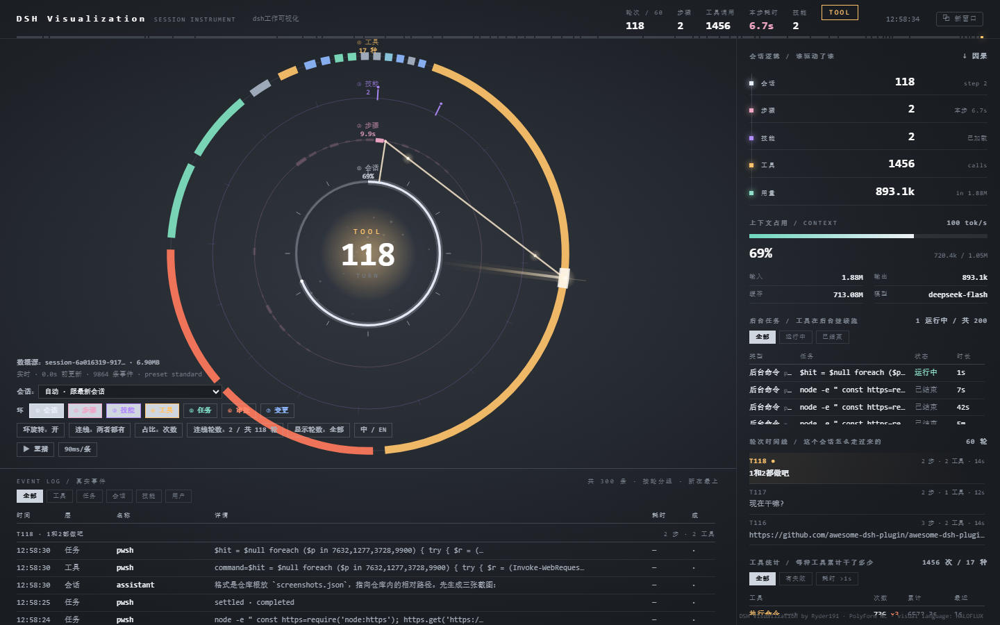

[中文](README.md) | **English**

# dsh-visualization

A **session instrument** for DeepSeek Harness: a sidebar icon that opens a live panel showing the
current session as seven rings, a turn timeline, per-step ladders, background jobs, approvals and
file changes — read straight from the session log, updated while the conversation runs.



**English** · **[中文](#中文)** below.

## Install

```powershell
# from the plugin market / Plugins page: search "dsh-visualization"
# or from npm:
npm i dsh-visualization
```

A ring icon appears in the left rail — click it to open the panel.

## Want it as a desktop wallpaper?

**You need [Lively Wallpaper](https://github.com/rocksdanister/lively)** (free, open source). It renders
the panel natively at the display's frame rate, and the panel stays clickable on the desktop.

1. Install Lively
2. Download [`wallpaper/lively-package.zip`](wallpaper/lively-package.zip) from this repository
3. Drag the zip into Lively

> Wallpaper Engine is **not** the recommended route: its own renderer crashes on this page (reproduced
> on its Chrome 146, independent of protocol and of the stylesheet). A screenshot-based workaround is
> documented in [wallpaper/README.md](wallpaper/README.en.md), but it runs at ~5 fps.

More: [GUIDE.md §8](GUIDE.en.md#8-as-a-desktop-wallpaper).

## Learn more

| Document | For |
|---|---|
| **[GUIDE.en.md](GUIDE.en.md)** | Using it: reading the rings, every control, wallpapers, troubleshooting |
| **[AGENTS.en.md](AGENTS.en.md)** | Changing it: file map, build rules, data flow, release flow, known traps |
| **[FAQ.en.md](FAQ.en.md)** | Why the license is non-OSI, privacy, limits |

**Requirements**: Node ≥ 22.15 in the host (the session log is zstd-compressed).

**License**: [PolyForm Noncommercial 1.0.0](LICENSE) — free for personal use, study, research and
teaching; commercial use is not granted. The visual language derives from
[HALOFLUX](https://github.com/Ryder191/haloflux), and that attribution stays.

---

