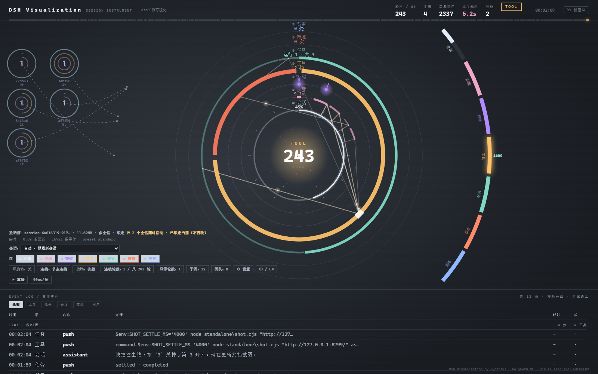

[中文](README.md) | [English](README.en.md) | [日本語](README.ja.md) | [한국어](README.ko.md) | [Русский](README.ru.md) | **हिन्दी**

# dsh-visualization

DeepSeek Harness के लिए **सत्र यंत्र**: साइडबार में छल्ले का आइकन खोलने पर मौजूदा सत्र सात परतों वाले
छल्लों, टर्न टाइमलाइन और चरण-सीढ़ी रेखाओं के रूप में बनता है, जिस पर टूल कॉल, बैकग्राउंड काम, स्वीकृतियाँ
और फ़ाइल बदलाव सब दिखते हैं। डेटा सीधे सत्र लॉग से पढ़ा जाता है और बातचीत के दौरान लाइव बदलता रहता है।



## इंस्टॉल

```powershell
# प्लगइन मार्केट में "dsh-visualization" खोजें
# या npm से:
npm i dsh-visualization
```

इंस्टॉल के बाद साइडबार में छल्ले का आइकन दिखेगा — क्लिक करने पर पैनल खुलता है।

## इंटरफ़ेस

छह भाषाएँ (中 / EN / 日 / 한 / РУ / हि), सातों छल्ले अलग-अलग चालू-बंद किए जा सकते हैं, अक्षर आकार और
सघन लेआउट भी समायोज्य, `Space` से रीप्ले, `1`–`7` से छल्ले बदलें। सेटिंग होस्ट की ओर सहेजी जाती है और
पैनल तथा वॉलपेपर दोनों साझा करते हैं।

## डेस्कटॉप वॉलपेपर के रूप में?

**[Lively Wallpaper](https://github.com/rocksdanister/lively)** (मुफ़्त, ओपन सोर्स) चाहिए। यह WebView2 से
पूरे फ़्रेम रेट पर बनाता है और डेस्कटॉप पर भी पैनल क्लिक करने योग्य रहता है।

1. Lively इंस्टॉल करें
2. इस रिपॉज़िटरी से [`wallpaper/lively-package.zip`](wallpaper/lively-package.zip) डाउनलोड करें
3. zip को Lively में खींचें

> केवल Lively समर्थित है: अन्य वॉलपेपर होस्ट (जैसे Wallpaper Engine) का रेंडरर इस पेज को नहीं बना सकता।

विवरण [GUIDE.md](GUIDE.en.md) में।

## दस्तावेज़

| दस्तावेज़ | किसके लिए |
|---|---|
| **[GUIDE.md](GUIDE.en.md)** | उपयोग: छल्ले पढ़ना, हर कंट्रोल, वॉलपेपर, समस्या-समाधान |
| **[AGENTS.md](AGENTS.en.md)** | बदलाव: फ़ाइल मैप, बिल्ड नियम, डेटा प्रवाह, रिलीज़ प्रक्रिया, ज्ञात जाल |
| **[FAQ.md](FAQ.en.md)** | OSI लाइसेंस क्यों नहीं, गोपनीयता, सीमाएँ |

**आवश्यकता**: होस्ट पर Node ≥ 22.15 (सत्र लॉग zstd संपीड़ित है)।

**लाइसेंस**: [PolyForm Noncommercial 1.0.0](LICENSE) — व्यक्तिगत उपयोग, अध्ययन, शोध और शिक्षण मुफ़्त;
व्यावसायिक उपयोग की अनुमति नहीं। दृश्य भाषा [HALOFLUX](https://github.com/Ryder191/haloflux) से है और
उसका श्रेय सुरक्षित रखा गया है।
