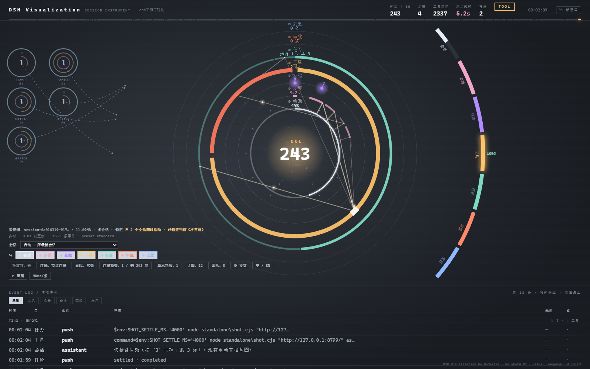

[中文](README.md) | [English](README.en.md) | **日本語** | [한국어](README.ko.md) | [Русский](README.ru.md) | [हिन्दी](README.hi.md)

# dsh-visualization

DeepSeek Harness 用の**セッション計器**。サイドバーのリングアイコンを開くと、現在のセッションが
七層のリング＋ターン履歴＋ステップのはしご線として描かれ、ツール呼び出し・バックグラウンド作業・
承認・ファイル変更がすべて載ります。データはセッションログを直接読み、会話中もリアルタイム更新。



## インストール

```powershell
# プラグインマーケットで "dsh-visualization" を検索
# または npm から：
npm i dsh-visualization
```

インストールするとサイドバーにリングアイコンが出て、クリックでパネルが開きます。

## インターフェース

六言語（中 / EN / 日 / 한 / РУ / हि）、七つのリングは個別にオン・オフ、文字サイズとコンパクト配置も
調整可能、`Space` でリプレイ、`1`–`7` でリング切替。設定はホスト側に保存され、パネルと壁紙で共有します。

## デスクトップ壁紙として使う？

**[Lively Wallpaper](https://github.com/rocksdanister/lively)**（無料・オープンソース）が必要です。
WebView2 でフレームレートいっぱいに描画し、デスクトップ上でもパネルをクリックできます。

1. Lively をインストール
2. 本リポジトリの [`wallpaper/lively-package.zip`](wallpaper/lively-package.zip) をダウンロード
3. zip を Lively にドラッグ

> Lively のみ対応：他の壁紙ソフト（Wallpaper Engine など）の描画エンジンではこのページを
> 合成できません。

詳しくは [GUIDE.ja.md](GUIDE.en.md) を参照。

## ドキュメント

| ドキュメント | 対象 |
|---|---|
| **[GUIDE.md](GUIDE.en.md)** | 使い方：リングの読み方、各コントロール、壁紙、トラブルシュート |
| **[AGENTS.md](AGENTS.en.md)** | 改造：ファイル構成、ビルド規則、データフロー、リリース手順、既知の罠 |
| **[FAQ.md](FAQ.en.md)** | OSI ライセンスにしない理由、プライバシー、制限 |

**動作要件**：ホストの Node ≥ 22.15（セッションログは zstd 圧縮）。

**ライセンス**：[PolyForm Noncommercial 1.0.0](LICENSE) —— 個人利用・学習・研究・教育は無料、商用利用は許諾しません。
視覚言語は [HALOFLUX](https://github.com/Ryder191/haloflux) 由来で、そのクレジットを保持します。
