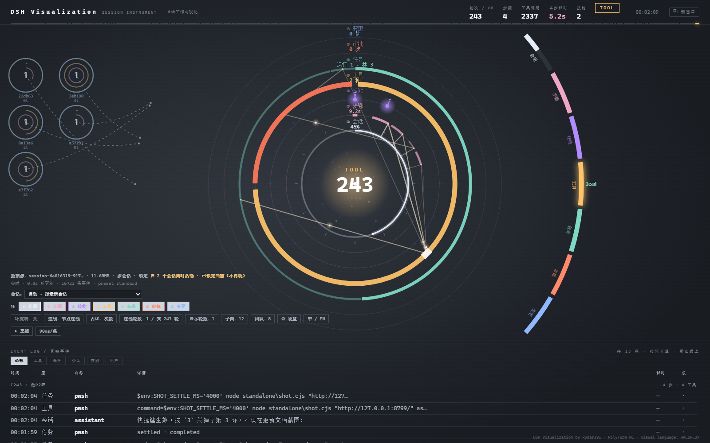

[中文](README.md) | [English](README.en.md) | [日本語](README.ja.md) | **한국어** | [Русский](README.ru.md) | [हिन्दी](README.hi.md)

# dsh-visualization

DeepSeek Harness용 **세션 계기판**. 사이드바의 링 아이콘을 열면 현재 세션이 일곱 겹의 링 + 턴 타임라인 +
단계별 사다리 선으로 그려지고, 도구 호출·백그라운드 작업·승인·파일 변경이 모두 올라갑니다.
데이터는 세션 로그를 직접 읽고 대화 중에도 실시간으로 갱신됩니다.



## 설치

```powershell
# 플러그인 마켓에서 "dsh-visualization" 검색
# 또는 npm에서:
npm i dsh-visualization
```

설치하면 사이드바에 링 아이콘이 생기고, 클릭하면 패널이 열립니다.

## 인터페이스

여섯 언어(中 / EN / 日 / 한 / РУ / हि), 일곱 링을 개별로 켜고 끌 수 있고, 글자 크기와 조밀한 배치도 조절
가능합니다. `Space`로 재생, `1`–`7`로 링 전환. 설정은 호스트에 저장되어 패널과 배경화면이 함께 씁니다.

## 데스크톱 배경화면으로 쓰기

**[Lively Wallpaper](https://github.com/rocksdanister/lively)**(무료·오픈소스)가 필요합니다.
WebView2로 화면 주사율만큼 그리며, 바탕화면에서도 패널을 클릭할 수 있습니다.

1. Lively 설치
2. 이 저장소의 [`wallpaper/lively-package.zip`](wallpaper/lively-package.zip) 내려받기
3. zip을 Lively로 끌어다 놓기

> Lively만 지원합니다. 다른 배경화면 프로그램(Wallpaper Engine 등)의 렌더러는 이 페이지를
> 합성하지 못합니다.

자세한 내용은 [GUIDE.md](GUIDE.en.md)를 보세요.

## 문서

| 문서 | 대상 |
|---|---|
| **[GUIDE.md](GUIDE.en.md)** | 사용법: 링 읽기, 각 컨트롤, 배경화면, 문제 해결 |
| **[AGENTS.md](AGENTS.en.md)** | 수정: 파일 구성, 빌드 규칙, 데이터 흐름, 릴리스 절차, 알려진 함정 |
| **[FAQ.md](FAQ.en.md)** | OSI 라이선스가 아닌 이유, 개인정보, 제한 |

**요구 사항**: 호스트 Node ≥ 22.15 (세션 로그가 zstd 압축).

**라이선스**: [PolyForm Noncommercial 1.0.0](LICENSE) — 개인 사용·학습·연구·교육은 무료이며 상업적
이용은 허가하지 않습니다. 시각 언어는 [HALOFLUX](https://github.com/Ryder191/haloflux)에서 왔고 그
크레딧을 유지합니다.
