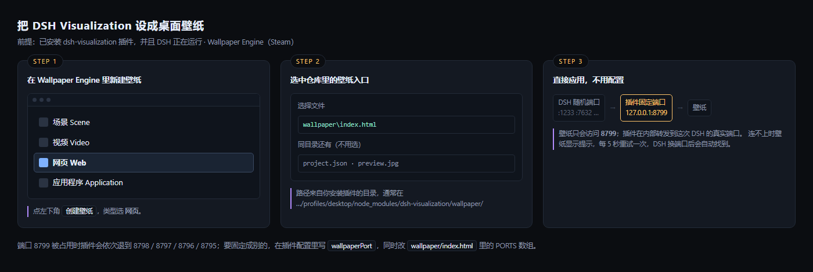

# DSH Visualization — session instrument for DeepSeek Harness

A layered instrument for a live DSH session: a sidebar icon, a full panel showing the session's
rings, turns, tools and background jobs.

**English** (below) · **[中文说明](#中文)** at the bottom.

> The standalone version (open `standalone/start.cmd`, no DSH plugin needed) lives in [`standalone/`](standalone/).

- **Seven rings**: ① session · ② steps · ③ skills · ④ tools · ⑤ jobs · ⑥ approvals · ⑦ changes — each one toggleable
- **Turn timeline**: two lines per turn — number + steps/tools/duration, then the prompt you typed
- **Connections**: per-step ladders (①→②→③→④) with dots running along them, or beams from the core
- **Hover / click**: every node on every ring answers — hover for its name, click for details (tools list the last six actual commands)
- **Turn scoping**: `show turns` / `line turns` knobs narrow the view to the last N turns
- Every display option is remembered in `localStorage`

---

# For users

## Requirements

- **Node ≥ 22.15** in the host: session logs are zstd-compressed. Without support the panel says so
  explicitly instead of rendering blank.
- Session directory defaults to `~/.dsh/sessions`; if DSH stores data elsewhere, set `DSH_HOME`
  or `DSHVIZ_SESSIONS_ROOT`.

## Install

```powershell
# local directory (development)
#   plugin_manager install_bundle, target = this directory
# from npm (after publishing)
#   search "dsh-visualization" on the Plugins page
```

A ring icon appears in the left rail; click it to open the instrument.

Or from npm: pm i dsh-visualization (package: https://www.npmjs.com/package/dsh-visualization).

## Reading the panel

| Area | What it tells you |
|---|---|
| Centre number | current turn; `TOOL` / `THINKING` / `IDLE` above it |
| ① session ring | context-window usage + the last 12 turn ticks |
| ② step ring | time buckets; thicker = more time spent in that slice |
| ③ skill ring | 16 slots; one lights up per loaded skill |
| ④ tool ring | composition by call count (or by time — see `share`) |
| ⑤ job ring | one arc per background job, length ∝ runtime |
| ⑥ approval ring | one tick per approval, colour = outcome |
| ⑦ change ring | one tick per file change; deliverables are taller |
| Right column | session flow, context, jobs, turn timeline, tool totals |
| Bottom | event log, grouped by turn |

Direction matters: on ②–⑦ the newest data sits at 12 o'clock and older data goes clockwise.

## The controls (bottom left)

| Control | Options |
|---|---|
| rings `①…⑦` | show/hide each layer; radii re-spread to fill the space |
| `spin` | slow rotation of ②③④ |
| `lines` | `ladders` / `beams` / `both` |
| `share` | tool ring sized by `count` or by `time` |
| `line turns` | how many turns get connectors (`2` by default) |
| `show turns` | how many turns every panel covers |
| `⧉ window` | open a separate window you can drag to another monitor |
| `中 / EN` | switch language |

`line turns` can never exceed `show turns` — the connector count is clamped automatically.

## Language

The UI ships in Chinese and English. It starts from `navigator.language`, remembers your choice,
and can be forced per page with `?lang=en` / `?lang=zh`.

## Using it as a desktop wallpaper

The panel can also run inside **Wallpaper Engine** (Steam). The plugin opens a small fixed-port
endpoint — `http://127.0.0.1:8799/` — because the DSH Web port changes on every launch and a
wallpaper cannot guess it.

**Requirements**: the plugin installed, and DSH running. If DSH is off the wallpaper shows a hint
and retries every 5 seconds; when DSH comes back on a different port the wallpaper finds it again.



**Install the wallpaper**

1. In Wallpaper Engine: **Create Wallpaper** → pick **Web** as the type
2. When it asks for a file, choose the `wallpaper/index.html` from this repository (or
   `wallpaper/project.json` if your version of WE asks for a project)
3. Save the project somewhere permanent and preview it. It connects to `127.0.0.1:8799` by itself.

**Changing the port**: the plugin tries 8799, then 8798, 8797, 8796, 8795. To use a different base
port, set `wallpaperPort` in the plugin config; set it to `0` to turn the endpoint off.

**If it stays on the "not connected" screen**

| Cause | Fix |
|---|---|
| DSH is not running | start it |
| the plugin is disabled | enable `dsh-visualization` on the Plugins page |
| 8799–8795 are all taken | set `wallpaperPort` to a free port and edit `PORTS` in `wallpaper/index.html` |
| CPU spikes while gaming | in Wallpaper Engine, enable "pause when a fullscreen app runs" |

## Using it as a desktop wallpaper

Two ways, depending on what the user already has installed.

### Lively Wallpaper (recommended — full frame rate)

[Lively](https://github.com/rocksdanister/lively) is free, open source, and renders web pages with the
same Chromium engine Edge uses, so the panel runs at the display's frame rate with real animation.

1. Install Lively Wallpaper
2. Download [`wallpaper/lively-package.zip`](wallpaper/lively-package.zip) from this repository
3. Drag the zip into Lively (or **Add Wallpaper → open file** → the extracted `index.html`)

The page finds the plugin on `127.0.0.1:8799` by itself; if DSH is not running it shows a hint and
retries every 5 seconds.

**The panel stays interactive on the desktop** — Lively forwards mouse input to the wallpaper, so the
ring toggles, turn pickers and detail cards all work directly on the background. If that makes desktop
icons hard to click, Lively's `Settings → desktop icons` toggle or per-wallpaper input setting turns
the forwarding off.

### Wallpaper Engine (screenshot mode)

Wallpaper Engine's own renderer crashes on this page (a CEF bug, reproduced on Chrome 146 and
independent of protocol — file:// and http:// both crash). The workaround ships here as a screenshot
pipeline: the page is captured to `frame.jpg` and the wallpaper just displays that image.

```powershell
node wallpaper-live.cjs 200 78     # ~4.9 fps, 200 KB per frame
```

Then set `wallpaper/live.html` as a Wallpaper Engine web wallpaper. See
`wallpaper/README.md` for the capture-pipeline variants (`8s` low-CPU vs `200ms` high-fps).

## When something looks wrong

| Symptom | Cause |
|---|---|
| Panel says "this runtime does not support zstd" | Node < 22.15 in the host |
| Panel says the session directory is empty | no session has run in this profile yet |
| Panel is empty with 403 in the network tab | you are not on loopback; set `allowRemote: true` (only on trusted machines) |
| A step ring segment is dim and has no line | that step is outside `line turns` — raise it, or lower `show turns` |
| A bright segment has no line | that step made no tool calls (a text-only step) |

---

# For plugin developers and agents

## Files

```
index.js        host entry: registers the /<basePath> route, injects origin + policy
fold.cjs        the whole host brain: session discovery, zstd frames, incremental fold, HTTP/SSE routes
client.js       client half: sidebar icon + a main-panel iframe pointing at the page
web/index.html  the instrument page (GENERATED — do not edit by hand)
build.cjs       regenerates web/index.html from ../instrument.html
cordis.patch.yml / locale/*.json / icon.svg   metadata
```

## Editing rules (the part that bites)

1. **The page has a single source: `instrument.html`** in the repository root. Edit that, then run
   `node build.cjs`. The build only rewrites absolute endpoints (`/state` → `state`) so the page works
   under a path prefix. Editing `web/index.html` directly will be overwritten.
2. **Host changes need a DSH restart.** `fold.cjs` and `index.js` are ESM modules; toggling the plugin
   only remounts the route — the loaded module is not re-evaluated. `client.js` and `web/*` pick up on
   a page refresh.
3. **Debug globals are gated**: `window.__M` / `__HIT` / `__CHAIN` only exist with `?debug=1`
   (or `#debug`, or `localStorage.dshviz.debug=1`).
4. **Never rewrite the page with a one-line shell command.** It has been destroyed that way once.
   Use edits, or author a small `.cjs` patch script and run it.

## Data flow

```
~/.dsh/sessions/<ws>/<session>/session.v<N>.jsonl.zstd
  └─ zstdFrames()   parse RFC 8878 headers+blocks → exact frame boundaries
  └─ unzstdAll()    decode only the frames appended since last read
  └─ makeFolder()   reducer: push(newEvents) → result()  (never re-scans history)
  └─ /dsh-visualization/state (one-shot)   /dsh-visualization/events (SSE, pushes only on change)
  └─ page: applyState() → render() (DOM) + draw() (canvas)
```

Cost at ~8.7k events: first fold 240–260 ms, then 7–12 ms per change. Frame parsing is exact, so a
partially-written tail frame simply stops the walk and is picked up next time.

## Adding things

**A new ring** — three places, all inside `instrument.html`:
`RINGVIS` / `RING_NAME` / `RING_COL` (state + labels), the `if (RINGVIS[n])` drawing block in `draw()`,
and `hitReg({ kind, r, a0, a1, label, data })` so hover/click works. Add a detail renderer branch in
`showDetail()` if the card needs fields.

**A new language** — `EN` map (whole-string matches), `EN_RULES` (templated phrases), `EN_FN`
(replacements that need logic). `LANG` currently accepts `zh` | `en`; to add a third, turn it into a
list and key the dictionaries by code.

**A new tool kind colour** — `toolColor(name)` in `instrument.html`.

## Config

| Field | Default | Meaning |
|---|---|---|
| `basePath` | `/dsh-visualization` | route prefix |
| `allowRemote` | `false` | allow non-loopback peers. **This exposes session logs to anyone who can reach the port.** |
| `wallpaperPort` | `8799` | fixed local port for the wallpaper entry; tries 8799 down to 8795. `0` disables it |

## Routes

| Path | Purpose |
|---|---|
| `/dsh-visualization/` | the page |
| `/dsh-visualization/state` | folded state, one-shot (`?session=<id>` to pin a session) |
| `/dsh-visualization/events` | same payload over SSE; pushed only when something changed (250 ms check) |
| `/dsh-visualization/sessions` | session list |
| `/dsh-visualization/select?session=` | switch the pinned session |
| `/dsh-visualization/calls?tool=&limit=` | recent calls of one tool, fetched on demand |
| `/dsh-visualization/replay?action=` | replay a session's history |

Limits: loopback-only by default, gzip on state, SSE capped at 8 concurrent clients.

## Performance notes

| Stage | Before | Now |
|---|---|---|
| Transport | 566 KB every 900 ms | 51 KB gzip, only on change |
| Decompression | whole log each time | only appended zstd frames |
| Fold | every event each time | only new events |
| Idle traffic | continuous polling | zero (15 s heartbeat only) |

## Known limitations

- **Memory grows with the session**: the reducer keeps derived state for every event. Steps/tools/log are
  capped; counters are cumulative. At ~100k events `result()` still sorts 1.2k steps and 1.5k tools,
  roughly 10–20 ms per frame.
- **Two UI languages only** (zh/en).
- **Read-only**: the instrument never writes session files.

## License

**[PolyForm Noncommercial License 1.0.0](./LICENSE)** — Copyright (c) 2026 Ryder191 (RYDER CODE / Ms MAIKEBAIs CAT).

- **Noncommercial only.** Personal use, study, research, teaching and hobby projects are free.
  Selling it, bundling it into a paid product, using it inside a company, or paid support is **not** permitted.
- **This is a derivative of HALOFLUX** (visual language, layout, rings, palette —
  https://github.com/Ryder191/haloflux). Per HALOFLUX's terms, derivatives must stay noncommercial and keep
  the attribution.
- **Keep the notices.** If you redistribute, pass along this LICENSE and its two `Required Notice:` lines.
- The page's bottom-right credit line (`DSH Visualization by Ryder191 · PolyForm NC · visual language: HALOFLUX`)
  must stay.

---

# 中文

把 DeepSeek Harness 的会话画成一台**分层仪表**：侧栏点一下，中间面板显示当前会话的环、轮次、工具和后台任务。

## 使用说明

**环境要求**：宿主 Node ≥ 22.15（会话日志是 zstd）。会话目录默认 `~/.dsh/sessions`，
DSH 装在别处时用环境变量 `DSH_HOME` 或 `DSHVIZ_SESSIONS_ROOT` 指过去。

**安装**：本地目录用 `plugin_manager install_bundle` 指向本目录；发布后可在插件页搜索 `dsh-visualization`。
安装后左侧栏出现环图标，点开即是仪表盘。

**怎么读**：中心数字是当前轮次，上方是状态（`TOOL`/`THINKING`/`IDLE`）。① 会话环是上下文占用 + 最近
12 轮刻度；② 步骤环按时间分格，格子越粗表示那段时间花得越久；③ 技能环 16 格，加载一个亮一个；
④ 工具环按调用次数（或耗时）分扇区；⑤ 任务环每个后台任务一段弧，弧长 = 运行时长；⑥ 审批环每次审批一根
刻度；⑦ 变更环每次文件改动一根刻度。**12 点方向是最新的，越旧越顺时针**。

**控件**（左下角）：七个环开关、环旋转、连线模式（阶梯/光束/两者）、占比口径、连线轮数、显示轮数、
`⧉ 新窗口`（拖到副屏）、`中 / EN`。`连线轮数` 不会超过 `显示轮数`，超了会自动钳制。

**语言**：默认跟随 `navigator.language`，选了就记住；也可以 `?lang=en` / `?lang=zh` 临时指定。

**常见现象**：

| 现象 | 原因 |
|---|---|
| 面板说"不支持 zstd" | 宿主 Node < 22.15 |
| 面板说会话目录是空的 | 这个 profile 还没跑过对话 |
| 面板空白、网络面板里 403 | 不是本机访问；需要远程看才把 `allowRemote` 打开 |
| 某个格子暗、没有线 | 它不在「连线轮数」范围内 |
| 格子亮、没有线 | 这一步没有工具调用（纯文字步） |

## 当桌面壁纸用（Wallpaper Engine）

这个面板也能放进 **Wallpaper Engine**（Steam）当桌面壁纸。插件会在本机开一个**固定端口**——
`http://127.0.0.1:8799/`——因为 DSH 的 Web 端口每次启动都会变，壁纸没法猜。

**前提**：装了插件，且 DSH 正在运行。DSH 关掉时壁纸显示提示并每 5 秒重试；DSH 换了端口重启，
壁纸会自己重新找到。


**导入步骤**

1. Wallpaper Engine 里点 **创建壁纸（Create Wallpaper）** → 类型选 **网页（Web）**
2. 选文件时指向本仓库的 `wallpaper/index.html`（如果你的版本要选工程，就选 `wallpaper/project.json`）
3. 存到固定位置，应用即可。它会自己连上 `127.0.0.1:8799`

**改端口**：插件会依次尝试 8799 → 8798 → 8797 → 8796 → 8795。想换起始端口，在插件配置里写
`wallpaperPort`；写 `0` 就是关掉这个入口。

**一直显示"没有连上"怎么办**

| 原因 | 处理 |
|---|---|
| DSH 没开 | 启动 DSH |
| 插件被禁用了 | 在插件页启用 `dsh-visualization` |
| 8795–8799 都被占用 | 配置里换个端口，同时改 `wallpaper/index.html` 里的 `PORTS` 数组 |
| 玩游戏时卡顿 | 在 Wallpaper Engine 里打开"其他应用全屏时暂停" |

## 当桌面壁纸用

两条路，看用户手上已经有什么。

### Lively Wallpaper（推荐，满帧）

[Lively](https://github.com/rocksdanister/lively) 免费开源，用 Edge 同款 Chromium 内核渲染网页，
所以面板能跑满显示器帧率、动画是真流畅的。

1. 装 Lively Wallpaper
2. 下载本仓库的 [`wallpaper/lively-package.zip`](wallpaper/lively-package.zip)
3. 把 zip 拖进 Lively（或者 **添加壁纸 → 打开文件** → 选解压后的 `index.html`）

页面会自己找到插件的 `127.0.0.1:8799`；DSH 没开时显示提示并每 5 秒重试。

**桌面上可以直接操作面板**——Lively 会把鼠标事件转给壁纸，环开关、轮次选择、详情卡片都能在桌面上点。
如果这导致桌面图标不好点，在 Lively 设置里关掉图标显示或该壁纸的输入转发即可。

### Wallpaper Engine（截图模式）

WE 自己的渲染器跑不动这个页面（CEF 的 bug，Chrome 146 复现，且与协议无关——file:// 和 http:// 都崩）。
仓库里附带截图流水线作为替代：页面被截成 `frame.jpg`，壁纸只负责显示这张图。

```powershell
node wallpaper-live.cjs 200 78     # 约 4.9 fps，每帧 200 KB
```

然后把 `wallpaper/live.html` 设成 WE 的网页壁纸。低 CPU 的 8 秒版见 `wallpaper/README.md`。

## 给 agent / 开发者的编辑说明

**文件**：`index.js`（宿主入口，注册路由 + 注入 origin/策略）、`fold.cjs`（会话发现、zstd 帧解析、
增量折叠、HTTP/SSE 路由）、`client.js`（侧栏图标 + 面板 iframe）、`web/index.html`（**生成物**）、
`build.cjs`（从主仓库 `instrument.html` 重新生成）。

**四条规矩**：

1. **页面只有一个源**：改 `../instrument.html`，再跑 `node build.cjs`。直接改 `web/index.html` 会被覆盖。
2. **改宿主必须重启 DSH**：`fold.cjs` / `index.js` 是 ESM，插件开关只会重挂路由，不会重新求值。
   `client.js` 和 `web/*` 刷新页面即可。
3. **调试全局是门控的**：`window.__M` / `__HIT` / `__CHAIN` 只在 `?debug=1` 时存在。
4. **绝不用单行命令整篇覆盖页面**——它被这样毁过一次。用编辑工具，或写一个 `.cjs` 补丁脚本再执行。

**数据流**：`张日志 → zstdFrames()（按 RFC 8878 精确切帧）→ 只解新帧 → makeFolder().push(新事件) →
/dsh-visualization/state（一次性）或 /dsh-visualization/events（SSE，变化才推）→ applyState() → render() + draw()`。

**8.7k 事件的开销**：首次 240~260ms，之后每次变化 7~12ms。

**加东西**：新环 = `RINGVIS`/`RING_NAME`/`RING_COL` + `draw()` 里的绘制块 + `hitReg(...)` 登记 +
`showDetail()` 的详情分支；新语言 = `EN` 词典 + `EN_RULES` 正则 + `EN_FN` 逻辑替换，并把 `LANG`
从 `'zh'|'en'` 改成列表；新工具配色 = `toolColor()`。

**配置**：`basePath`（默认 `/dsh-visualization`）、`allowRemote`（默认 `false`，打开等于把会话日志暴露给能访问该端口的人）、
`wallpaperPort`（默认 `8799`，壁纸用的固定端口，写 0 关闭）。

**已知限制**：内存随会话线性增长（十万条时每帧 `result()` 约 10~20ms）；界面只有中英两门语言；
仪表只读，从不写会话文件。

## 许可证

**[PolyForm Noncommercial License 1.0.0](./LICENSE)** —— Copyright (c) 2026 Ryder191（RYDER CODE / Ms MAIKEBAIs CAT）。

- **仅限非商业用途**：个人学习、兴趣项目、研究、教学可自由使用、修改、分享。
  **禁止**：出售、集成进付费产品、在公司内部或代表公司使用、接单或有偿项目。
- **本项目是 HALOFLUX 的衍生作品**（视觉语言、布局、环与配色均来自
  https://github.com/Ryder191/haloflux）。按 HALOFLUX 的条款，衍生作品必须同为非商业并保留署名。
- **保留声明**：转发时附带本 LICENSE 与其中的两行 `Required Notice:`。
- 页面右下角署名（`DSH Visualization by Ryder191 · PolyForm NC · visual language: HALOFLUX`）不得删除。
