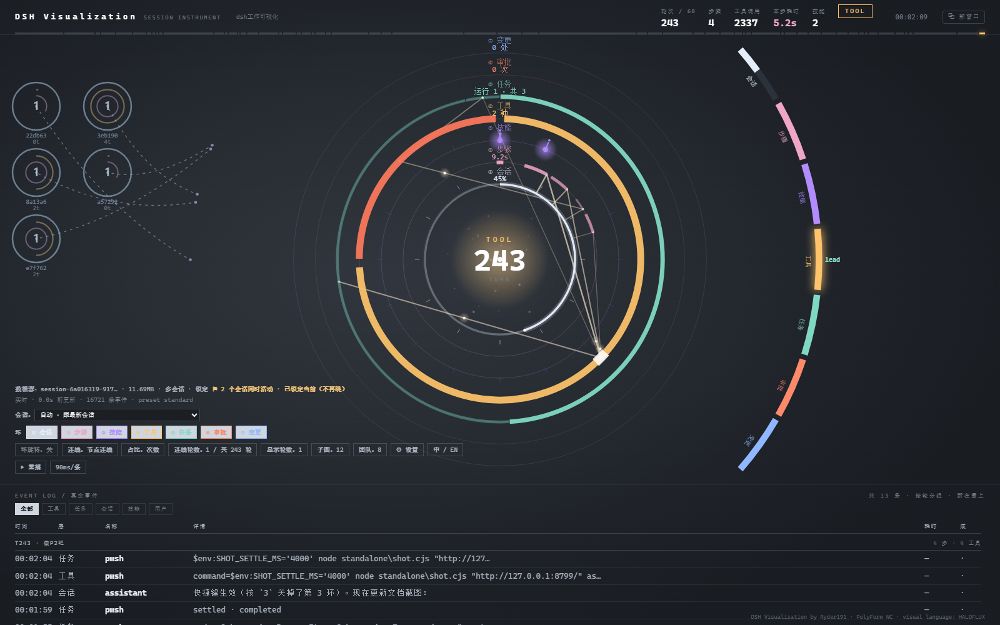

**[中文](README.md)** | [English](README.en.md)

# dsh-visualization

DeepSeek Harness 的**会话仪表盘**：侧栏一个环图标，打开后把当前会话画成七层环 + 轮次时间线 +
逐步阶梯连线，工具调用、后台任务、审批、文件变更都在上面，数据直接读会话日志，对话进行中实时更新。



## 安装

```powershell
# 插件市场 / 插件页搜索 "dsh-visualization"
# 或者从 npm 装：
npm i dsh-visualization
```

装好后左侧栏出现环图标，点开就是面板。

## 界面

六种语言（中 / EN / 日 / 한 / РУ / हि）、七环可单独开关、字号与紧凑布局可调、`Space` 重播 `1-7` 切环。
设置存在宿主侧，面板与壁纸共用。

## 想当桌面壁纸用？

**需要先装 [Lively Wallpaper](https://github.com/rocksdanister/lively)**（免费开源）。它用原生内核
满帧渲染，且面板在桌面上依然可以点击操作。

1. 装 Lively
2. 下载本仓库的 [`wallpaper/lively-package.zip`](wallpaper/lively-package.zip)
3. 把 zip 拖进 Lively

> 只支持 Lively：其它壁纸软件（例如 Wallpaper Engine）的渲染内核跑不动这个页面，没有可用方案。

详细说明：[GUIDE.md §8](GUIDE.md#8-当桌面壁纸用)。

## 更多文档

| 文档 | 给谁看 |
|---|---|
| **[GUIDE.md](GUIDE.md)** | 怎么用：怎么读环、每个控件、桌面壁纸、排错 |
| **[AGENTS.md](AGENTS.md)** | 怎么改：文件地图、构建规则、数据流、发布流程、踩过的坑 |
| **[FAQ.md](FAQ.md)** | 为什么不用 OSI 许可、隐私、限制 |

**环境要求**：宿主 Node ≥ 22.15（会话日志是 zstd 压缩的）。

**许可**：[PolyForm Noncommercial 1.0.0](LICENSE) —— 个人使用、学习、研究、教学免费，不授予商业用途。
视觉语言来自 [HALOFLUX](https://github.com/Ryder191/haloflux)，该署名保留。
