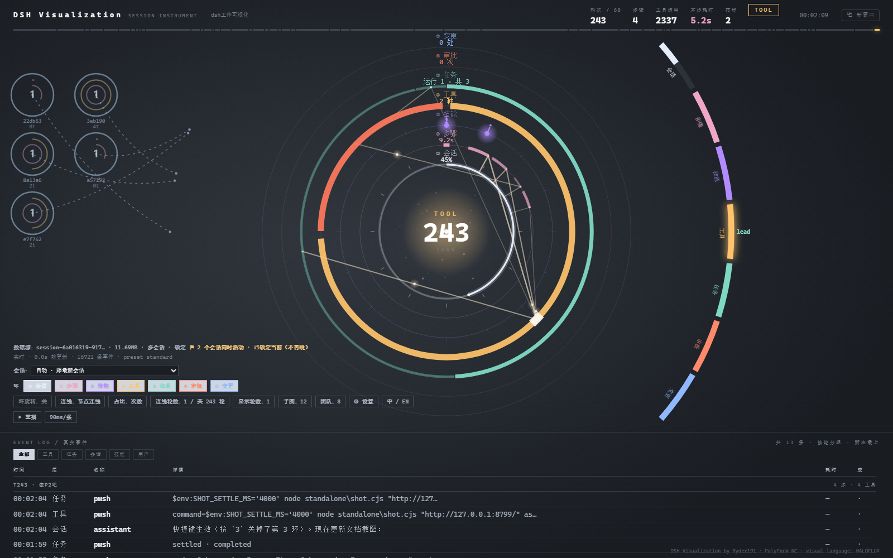

[中文](README.md) | [English](README.en.md) | [日本語](README.ja.md) | [한국어](README.ko.md) | **Русский** | [हिन्दी](README.hi.md)

# dsh-visualization

**Прибор сессии** для DeepSeek Harness: значок кольца в боковой панели открывает текущую сессию,
нарисованную как семь колец плюс хронология ходов и лестницы шагов; на них видны вызовы инструментов,
фоновые задачи, апрувы и правки файлов. Данные читаются прямо из журнала сессии и обновляются на ходу.



## Установка

```powershell
# Найдите "dsh-visualization" в маркете плагинов
# или установите из npm:
npm i dsh-visualization
```

После установки в боковой панели появится значок кольца — нажмите, чтобы открыть панель.

## Интерфейс

Шесть языков (中 / EN / 日 / 한 / РУ / हि), каждое из семи колец можно включать отдельно, размер текста и
компактная раскладка настраиваются, `Space` — повтор, `1`–`7` — переключение колец. Настройки хранятся
на стороне хоста и общие для панели и обоев.

## Как обои для рабочего стола?

Нужен **[Lively Wallpaper](https://github.com/rocksdanister/lively)** (бесплатный, открытый). Он рисует
через WebView2 на полной частоте кадров, и панель на рабочем столе остаётся кликабельной.

1. Установите Lively
2. Скачайте [`wallpaper/lively-package.zip`](wallpaper/lively-package.zip) из этого репозитория
3. Перетащите zip в Lively

> Поддерживается только Lively: движки других хостов обоев (например, Wallpaper Engine) не могут
> отрисовать эту страницу.

Подробнее — в [GUIDE.md](GUIDE.en.md).

## Документация

| Документ | Для кого |
|---|---|
| **[GUIDE.md](GUIDE.en.md)** | Как пользоваться: чтение колец, элементы управления, обои, решение проблем |
| **[AGENTS.md](AGENTS.en.md)** | Как менять: карта файлов, правила сборки, поток данных, релиз, известные ловушки |
| **[FAQ.md](FAQ.en.md)** | Почему лицензия не OSI, приватность, ограничения |

**Требования**: Node ≥ 22.15 на хосте (журнал сессии сжат zstd).

**Лицензия**: [PolyForm Noncommercial 1.0.0](LICENSE) — личное использование, учёба, исследования и
преподавание бесплатны; коммерческое использование не разрешено. Визуальный язык взят из
[HALOFLUX](https://github.com/Ryder191/haloflux), атрибуция сохранена.
